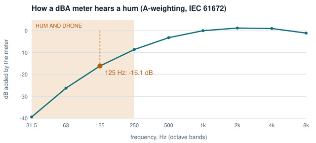

# Feedstock Open

Open research on turning industrial liabilities into feedstocks: waste heat, brine, cold and noise,
treated as things to recover instead of things to dump. The first line of work here is **CryoCap**,
on quieter, smarter heat rejection for data centers.

By Alexander Smith, independent researcher, central Pennsylvania. I wait tables by day and chase
data center noise the rest of the time. Everything here is free for anyone to use and build on.

**Start here**

- **Checking the liquid-air thermodynamics?** The calculation is in
  [cryocap/liquid-air-cop-check.md](cryocap/liquid-air-cop-check.md) (also as a
  [PDF](cryocap/liquid-air-cop-check.pdf)). It is not in the published record yet.
- **Opening the published paper?** It covers three families of systems, and the first one
  (geothermal brine, desalination, membranes) is not CryoCap. CryoCap is **Section 4**,
  Embodiment Family B.

---

## CryoCap: the meter doesn't hear what the neighbors hear

Data centers have to throw away an enormous amount of heat, and the outdoor fans that do it are
what the neighbors hear at 3 AM.

Most noise limits are written in dBA, an overall level that discounts low frequencies roughly the
way a human ear does at moderate loudness. That works for broadband sound. It works badly for the
steady hum and tones that large banks of outdoor cooling fans produce. A site can pass a dBA limit
and still draw complaints, because what people object to is a tone that won't go away.

The standard A-weighting correction (IEC 61672) counts a steady hum near 125 Hz about 16 dB
quieter than it is. So I aim designs at narrowband levels and tonality at the property line, not
just overall dBA.

### What I'm working on

| Thread | Status | The idea |
| --- | --- | --- |
| Quiet hours | Write-up drafted | A plant-level interlock holds the outdoor heat-rejection plant under its night-time sound budget, and stored heat carries the load through the quiet window. The worst case on paper is also the quiet case, and a mitigation that can't fail open is one a permit reviewer can trust. |
| Low-tone fan | Modeled across real coils | A ducted dry-cooler fan stage whose geometry keeps the strongest fan tones inside the duct until they are high enough in pitch for ordinary acoustic lining to absorb. I've now run it across the coil pressure drops typical dry coolers see, and on paper it holds. Next is checking it against measured fan data. |
| Coolant temperature | Estimate | Rank cooling systems by coolant temperature, not fan count. Warmer coolant lets the outdoor fans turn slower, and fan noise falls steeply with speed. On one vendor's own published numbers, hot-water direct-to-chip cooling comes out roughly 18 dB quieter at the property line than single-phase immersion. I'd like to test that against field data. |
| Corrections | In preparation | My August publication paired a liquid-air energy store with data center cooling. Working through it since, the cold side loses to an ordinary chiller. That correction is being published openly, because a wrong number that supports a right idea is still a wrong number. The core calculation is here now: [COP check](cryocap/liquid-air-cop-check.md). |

### What would help

- Field recordings or spectra from near data center heat-rejection plants, especially tonal or
  low-frequency complaints.
- Pressure-drop curves for real data center dry-cooler coils.
- A thermodynamics check on the liquid-air correction, starting with the
  [COP check](cryocap/liquid-air-cop-check.md).
- A view from people who permit or run sites: would a hard interlock count as a noise mitigation
  where you work?

---

## Published record

I publish as defensive publications under Creative Commons Attribution 4.0, so the ideas stay open
and anyone can build on them.

- **Cascaded Liability-to-Feedstock Resource Recovery Architectures: Geothermal-Desalination-Membrane-Mineral
  Stacks, Cryogenic Storage-Air Separation-Datacenter Cascades, and Parallel-Topology Hybrid Storage.**
  Technical Disclosure Commons, Defensive Publications Series, Art. 11407, published 18 August 2026.
  Archive: [doi.org/10.5281/zenodo.21938808](https://doi.org/10.5281/zenodo.21938808).
  The paper covers three families. Family A (geothermal brine, desalination, membranes) comes first;
  **CryoCap is Section 4, Embodiment Family B.** The liquid-air COP calculation is not in this record
  yet; it is in the [COP check](cryocap/liquid-air-cop-check.md) and will be published as a formal
  amendment.
- **Amendment 1**, 21 August 2026:
  [doi.org/10.5281/zenodo.22040228](https://doi.org/10.5281/zenodo.22040228)

Figures in this README are working estimates unless they come from the published record above.

## Get in touch

Questions, corrections and "this already exists" are all welcome. Open an
[issue](../../issues) on this repository and I'll see it.

## License

The text and figures in this repository are licensed under
[CC BY 4.0](https://creativecommons.org/licenses/by/4.0/). See [LICENSE.md](LICENSE.md).
